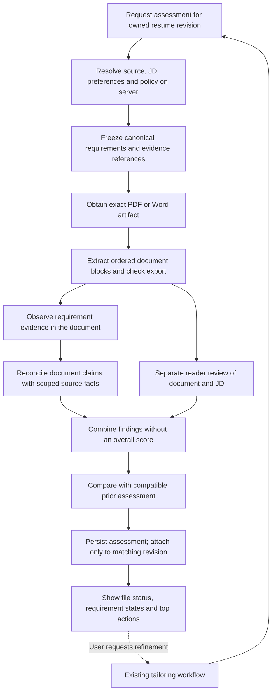

# ATS engine master implementation plan

Status: implementation specification, 2026-09-05. This document consolidates the [current-engine audit](2026-09-05-ats-measurement-audit-and-plan.md) and [reverse review](2026-09-05-ats-plan-reverse-review.md). It is the authoritative execution plan for the next assessment changes. It does not claim those changes are implemented, deployed, or validated by employers.

## 1. Product outcome and boundaries

Give a user a defensible answer to: “Does this specific resume file clearly present my relevant experience for this job, and what is worth improving?”

The engine measures four separate things:

1. Actual-file readability and content preservation.
2. What the document demonstrates against the job's requirements.
3. Whether its factual claims are supported by the correct source experience.
4. Reader clarity, specificity, relevance and naturalness.

Known application eligibility is separate context. `fit_score.py` remains the only candidate-to-job match formula. Resume assessment must not overwrite `match_score`, change candidate qualification because wording changed, or simulate a particular employer's private screening settings.

No public overall ATS percentage or visibility percentage at initial launch. Show requirement counts, actual-file status, concrete changes, and the top useful actions. No simulated Workday/Greenhouse/etc. scores, culture-fit number, screening probability, keyword-frequency reward, forced metrics, fixed technology quota or mandatory summary.

The engine must support all professions. Healthcare, GenAI, software infrastructure and other specializations matter only when relevant and supported. Qualitative outcomes, transferable experience, projects and early-career resumes remain valid.

Ordinary reframing does not require a user answer. Optional questions are for material new facts, never a prerequisite for checking the available resume. A good original sentence may remain unchanged.

## 2. What is retained versus replaced

| Retain | Replace or extend |
|---|---|
| Existing async jobs, provider facade, ownership/guest-session checks, quotas and version limits | Marker-selected legacy versus new scoring logic; one server-resolved assessment service |
| New source-scoped tailoring, edit locks, omissions, optional confirmed additions and bounded repair | Flat requirement matching that loses action, ownership, qualifiers and AND/OR structure |
| Existing renderer and real PDF/DOCX generation | Constant format scores and substring-only export assurance |
| Source snapshots and content hashes already introduced | Incomplete assessment identity, cache dependencies and client-authoritative score sidecars |
| Separate reader pass and current assessment UI foundation | Quote-only findings that cannot represent absence; completion treated as quality success |
| Existing candidate/job `fit_score` | Keyword-heavy resume overall formula and assumed AI defaults |
| Historical saved results and files | Fresh calculations using legacy simulated scanner scores |

Do not delete historical records or rerun paid model calls in a bulk migration. A user-requested reassessment creates a new versioned assessment without changing resume prose or historical assessments.

## 3. Canonical workflow

The observer and reader see canonical employer requirements and the actual extracted document. They do not see the writer's intended matches, source-only accomplishments, scores or private reasoning. The reconciler sees document claims and the appropriate source evidence. These are separate inputs and responsibilities, not claims that model judgments are statistically independent.

No assessment stage rewrites the resume. Tailoring owns its existing single bounded repair pass. A repaired draft must receive new affected checks before its result is described as current.

## 4. Contracts to implement first

Use `assessment-v2` for the new rubric and an API discriminant such as `schema_version: 4`. Confirm naming against existing schema consumers during implementation; do not reuse an old version for changed semantics.

### 4.1 Assessment request and server snapshot

Request: record ID, resume version ID, requested format, optional previous assessment ID, and idempotency key. An edited draft supplies its document content plus expected parent revision; it does not supply authoritative provenance or trusted scores.

Server snapshot: owner scope, source snapshot ID/hash, confirmed-evidence snapshot/hash, JD source/hash, canonical requirement version/hash, document content/hash, preferences/omissions hash and pinned assessment policy versions.

Guest requests resolve the same information through existing guest-session authorization. Detached drafts with unavailable source can receive file/reader checks, with source support explicitly unresolved. Never substitute another active base resume silently.

### 4.2 Canonical requirement expression

Every top-level group includes:

- Stable requirement ID within a versioned JD interpretation.
- Original JD span, display wording and provenance.
- Explicit priority: required, preferred or unspecified.
- Kind: capability, responsibility, credential, duration, domain or application context.
- Expression: atomic predicate, AND group, OR group or unresolved ambiguity.
- Explicit qualifiers and their scope; no invented employer importance or requirements.
- Extraction state: complete, partial or ambiguous.

An atomic predicate records the capability/tool, action/relationship, stated context, ownership if required, duration/currency if required, and evidence expectation. Missing qualifiers remain absent.

Example: “Python or Java, plus SQL” becomes `AND(OR(Python, Java), SQL)` only when the wording supports that interpretation. “Python or Java and SQL” may remain ambiguous. Repeated paraphrases are one canonical group. Do not flatten every component into a separate headline requirement.

### 4.3 Parsed artifact

Record exact bytes hash, MIME/format, renderer version, extractor version, page count where available, ordered blocks, raw text, normalized text, offsets, page/region where available, section candidates, entity associations and extraction completeness.

Keep observed structure distinct from the intended resume structure. Expected company/bullet associations are comparison targets, not evidence that parsing recovered them. An unresolved association is unknown.

Normalization may normalize equivalent Unicode and spacing, but must preserve word boundaries, order and entity relationships. `SQL` must not match `NoSQL` by substring. Do not concatenate all DOCX paragraphs followed by all tables; traverse actual document order.

### 4.4 Requirement evaluation

Keep these fields independent:

| Field | Purpose |
|---|---|
| `document_state` | satisfied, partially_supported, not_demonstrated, contradicted, unknown |
| `source_state` | supported, listed_only, related, not_evidenced, contradicted, unknown |
| `claim_state` | supported_explicit, supported_semantic, unverified, contradicted |
| `match_method` | exact, recognized_alias, semantic, none |
| `document_refs` | Exact extracted spans and actual section/entity |
| `source_refs` | Immutable scoped fact references |
| `unmet_qualifiers` | Specific action/context/duration/etc. not established |
| `reason` | Short user-readable explanation |
| `dependencies` | Snapshot, requirement, entity and check versions used |

Full headline credit requires that the document satisfies the requirement and the relevant factual claims are supported. A clearly written unsupported claim does not become a demonstrated match. Source-backed content missing from the file is not document evidence.

For a generic tool requirement, a Skills entry may be sufficient to show the candidate lists that skill, and the UI must say that is the evidence. It cannot satisfy a requirement for production use, ownership or a particular duration. Do not impose those stronger expectations unless the JD asks for them.

### 4.5 Findings and final response

Each finding has a kind, severity, explanation, applicable requirement, relevant references, completion state and suggested action type.

- Wording/strength findings cite resume spans.
- Absence findings cite the JD requirement and the completed document search scope.
- Relationship findings cite both affected entities/spans.
- Visual findings cite the inspected page/region and observed defect.

Severity: critical integrity/file issue, material presentation issue, advisory, informational. A generic reviewer preference must not become a critical gate.

Response includes an assessment ID, snapshot identity, per-stage status, format-specific artifact checks, requirement evaluations/counts, claim findings, reader findings, top actions, compatible comparison, and application-context references. New responses have no invented numeric legacy aliases. Explicit `null`/unknown states are supported by the frontend type union.

## 5. Measurement rules

### 5.1 File checks

Evaluate the exact artifact requested or downloaded:

- Can text be extracted, and from all expected pages/parts?
- Did intended contact details, accomplishments, qualifications and skills survive?
- Are tokens readable rather than corrupted or joined?
- Can job titles, employers, dates and their bullets be associated correctly?
- Did the renderer clip, omit or shrink content beyond its documented layout constraints?
- Are relevant headings and reading order recognizable for this particular document?

Missing optional sections are not a penalty. A user-excluded bullet is not export loss. A renderer-dropped bullet present in the intended document is export loss. PDF and Word outcomes are separate. A one-page template is not a universal rule for every profession or seniority.

Report observed pass/issues/failure/unchecked states with applicability. Local parser success is not a vendor certification. Use a second extractor and visual fixtures in validation cohorts; disagreement is actionable uncertainty.

### 5.2 Requirement and factual evaluation

Recognize synonyms and meaningful action-based entailment without forcing JD wording. Distinguish evaluation, implementation, operation, integration with another team's system, ownership, migration away and historical use. Preserve negation.

Evaluate AND/OR expressions deterministically over atomic observations:

- AND is satisfied only when all mandatory children are satisfied. An explicit contradiction in a mandatory child prevents full satisfaction.
- OR is satisfied when one complete alternative is satisfied; an unresolved alternative cannot be silently treated as satisfied or contradicted.
- When an unresolved child could change the conclusion, return unknown with known child findings retained.
- A failed full match with genuine limited positive evidence can be partial. Absence after a complete search is not demonstrated, not contradiction.

The reducer's complete truth table belongs in code/tests before rollout. Models propose scoped observations; they do not choose the final reducer rules.

Source evidence may combine across distinct jobs for an aggregate requirement, with each relationship retained. For duration, union only evidence-backed relevant time intervals. Overlapping roles are not double-counted. Full job tenure does not establish continuous use of every tool mentioned in that job. Uncertain date precision remains uncertain.

Actual source employers/titles/dates remain protected. A bullet moved to another employer must fail source reconciliation even if its text is unchanged. Source-backed credentials mean “stated in your source,” not independently verified credentials.

### 5.3 Counting and priority

Count each canonical top-level requirement group once. Break counts into required, preferred and unspecified. Use mutually exclusive display buckets, derived from the independent fields: supported and satisfied; partial/listed/related evidence; not demonstrated; explicit conflict; unknown. Subdetails explain why. Preserve all actual employer requirements, including ones the candidate cannot meet.

Do not derive priority from JD repetition. Explicit mandatory constraints remain distinct from inferred editorial relevance. Unknown importance stays unspecified. A critical explicit requirement must remain visible even when many minor requirements are satisfied.

Do not expose the experimental supported-visibility percentage at launch. If retained internally, freeze its source-supported denominator, use the same evaluator for both documents, make zero/incomplete denominators null, and never treat it as a job-match score.

### 5.4 Search discoverability

Use named skills and recognized aliases as advisory search checks. One useful supported naming clarification may help. Repetition earns no additional requirement credit. Related technologies are not aliases. A term present in unrelated employment cannot establish the requested context elsewhere.

Do not insist on copying long JD sentences. Accurate conventional wording is not automatically over-tailoring. Adding an acronym expansion may improve discoverability while leaving semantic coverage unchanged.

### 5.5 Reader quality and retention

Review positioning, concrete contribution, useful detail, relevance, concision, natural language, repetition, and whether different jobs implausibly sound identical. Do not reward word count, metric count, invented impact or forced verb rotation.

The final-document reader sees only the document and JD. A separate comparison stage may see the base and tailored documents to identify lost accomplishment detail; it must cite those documents and not feed hidden source facts into the blind final-document read.

More coverage with weaker concrete work or an overloaded page can be a regression. Equal coverage with clearer wording can be an improvement. Strong original wording retained unchanged is valid.

### 5.6 Comparisons

Classify changes as:

1. Coverage gained/lost under the same canonical requirements and evidence basis.
2. Clarity/discoverability improved or worsened with specific passages.
3. New candidate-confirmed source evidence added.
4. Export improvement/regression for the relevant format.

Both versions use the same evaluator/rubric and compatible source/JD snapshots. If source or rubric changes, re-evaluate both on a common basis or state that they are not directly comparable. Do not label rewording “new coverage” when both versions already demonstrate the capability.

## 6. Status and action policy

Keep processing status separate from assessment judgment:

- Processing: pending, running, complete, partial, failed, superseded.
- Artifact: passed, issues, failed, unchecked.
- Source check: complete, partial, unresolved.
- Reader: completed, unavailable, partial, with separate findings/severity.
- Comparison: comparable, not_comparable, unavailable.

The user sees a concise status such as “Review complete,” “Review incomplete,” or “File needs attention,” not an unexplained ready boolean. Show the top three useful actions and expandable details. Preserve completed checks when another stage fails.

Automated-use eligibility is a separate derived policy consumed by existing preparation workflows. Preserve existing authorization and candidate/eligibility gates. Critical factual contradictions, mismatched snapshots and unreadable files must not be silently treated as eligible. Advisory wording preferences or a known job gap do not become new universal submission blocks. An assessment never authorizes sending an application.

A source fact is not externally verified simply because the user uploaded or confirmed it. Use accurate labels. Optional questions do not suspend the worker and do not block delivery of the available draft.

## 7. Service and persistence design

### 7.1 Module responsibilities

Prefer small modules under the existing shared service layer; do not add namespace-breaking `__init__.py` files.

| Module | Responsibility |
|---|---|
| `schemas/assessment_contracts.py` (new) | Request/result types, statuses, expressions, observations and validation |
| `services/assessment_policy.py` (new) | Rubric versions, applicability, severity/reducer rules and budgets |
| `services/assessment_service.py` (new) | Async orchestration, stage dependencies, persistence and idempotency |
| `services/requirement_assessment.py` (new) | Artifact observations, predicate/group evaluation and source reconciliation |
| `services/artifact_assessment.py` (new) | Ordered PDF/DOCX extraction, associations, retention checks and artifact identity |
| `services/assessment_comparison.py` (new) | Comparable before/after findings without a new match formula |
| Existing `tailoring_assessment.py` | Compatibility facade delegating to the canonical service; remove duplicate evaluation rules |
| Existing `resume_scorer.py` | Compatibility facade and historical adapters; stop new simulated scoring |

Reuse existing provider, render, normalization, source-fact, ownership and job services. Extract existing reader logic into the canonical service boundary rather than implementing another independent scorer alongside it.

### 7.2 Authoritative storage

Add a `resume_assessments` collection, storing immutable completed assessment records and explicit stage progress for running jobs. Store large artifacts using existing storage; persist references and hashes, not duplicate file bytes in Mongo.

Create indexes through an explicit, reviewable setup/migration step:

- Unique assessment ID.
- Owner scope + idempotency key uniqueness for request deduplication.
- Owner scope + record/version/format + creation time for retrieval.
- Dependency fingerprint lookup for compatible reuse.

Idempotency keys bind to request fingerprints: reusing a key with different inputs is a conflict. Attach the assessment ID to a resume version atomically only if expected content/source/JD identity still matches. A late result can be retained as superseded history but must not replace the current assessment.

Do not let client-submitted `ats_scores`, `document_assessment` or `tailoring_run` establish factual support. Saved source/JD snapshots, server checks and verified ownership are authoritative. Follow existing retention and deletion policies, extending deletion/export workflows to include assessment records and scoped references. Do not add a blanket TTL that deletes assessments still referenced by saved versions.

### 7.3 API and caller integration

Use the existing authenticated/guest async request and job-polling conventions. Add a canonical request/result API if useful; retain `/ats-scores` as an adapter during migration. Adapt save-version requests to carry an assessment ID, with validation, rather than trusting arbitrary score bodies.

All callers must be inventoried and tested: initial tailoring, combined JD/tailor, regeneration, guest tailoring/claiming, batch, job-search shortcut, standalone recheck, edited drafts, reopening saved versions, PDF/Word download and auto-apply preparation. Separate absence of source data from failure to locate an owned source.

Checking a new output format triggers the appropriate file assessment. Never reuse PDF checks as Word assurance. Downloading an unsaved draft must not overwrite a saved artifact. Do not make new model calls synchronously from HTTP download routes; return stored checks or queue assessment with an honest pending status.

## 8. Invalidation, caching and execution budgets

| Change | Recompute |
|---|---|
| Bullet wording | Its document observation and source claim; affected requirements; reader when meaningful |
| Bullet moves between jobs | Both entity associations, source support, affected requirements and reader |
| Heading/date/role structure | Associated block mapping and all dependent claims; artifact and reader |
| Summary change | Summary claims, affected requirements, positioning/reader and artifact |
| Skills change | Affected skill observations, support and discoverability; artifact and relevant reader checks |
| JD or source evidence changes | Canonical dependencies and affected assessments; comparison compatibility |
| Renderer/extractor change | Artifact and any dependent structure/visible-content evaluation |
| Rubric/model/prompt change | Dependent semantic/reducer/reader checks |
| Byte-only metadata change | File identity/checks; reuse semantic results only if ordered content and structure match |

Source relationship caches include entity, claim, source fact hashes and verification-policy version. Reader caches include ordered document structure, JD interpretation and model/rubric version. Never flatten away order or word boundaries to get a cache hit.

Proposed initial assessment call budget: one batched document observation, one batched entailment pass for uncached claims, one separate reader pass. An optional base-versus-tailored comparison is a separately budgeted job and must not hide extra calls in the standard path. Prefer deterministic comparison of completed observations; request an editorial comparison only when useful.

Set explicit input/output and total-call limits before enabling the flag. Whole-record chunking must fit those limits; excess scope becomes partial rather than generating one call per requirement. Count provider retries/JSON repair against the run deadline. Debounce edits and coalesce repeated rechecks. Share the overall deadline with the parent tailoring job so assessment cannot consume the time needed to persist the resume.

Operational budgets are configuration, not assertions of current performance. Initial proposed staging targets: typical one/two-page standalone assessment p95 at most 90 seconds, hard deadline at most 120 seconds or the parent's smaller remaining budget, with at least 15 seconds reserved for persistence/partial delivery. Confirm feasibility against actual worker/provider limits and measure cost before release; revise explicit targets if evidence warrants it. Model failure yields partial/unknown, never default 70 or format 95.

## 9. Ordered implementation packages

### Package 0 — Baseline and caller inventory

- Record current working-tree changes and preserve the already implemented tailoring work.
- Map every score reader/writer and every artifact path.
- Capture deterministic failure cases from the audit and reverse review as fixtures.
- Record baseline calls, latency and current response shapes using offline fixtures; add live measurements only in the designated evaluation stage.

Deliverable: caller matrix, fixture inventory, baseline report. Exit: every new assessment entry point and legacy consumer is accounted for.

### Package 1 — Contracts and evaluator invariants

- Add versioned request/result contracts and the requirement expression/reducer truth table.
- Define evidence expectation, statuses, finding-reference types and applicability/severity policy.
- Add discriminated frontend types; prevent missing information becoming numeric zero.
- Specify no overall numeric score and no public visibility percentage.

Deliverable: shared validated contract and reducer tests. Exit: AND/OR, ambiguity, partial/unknown and display counting behave deterministically.

### Package 2 — Ownership, revision binding and async skeleton

- Add canonical assessment service, ownership resolution and immutable snapshots.
- Add collection/index setup, idempotency and atomic current-assessment attachment.
- Implement job progress, cancellation/supersession and partial-result persistence.
- Adapt legacy requests to the new request identity without yet exposing new results broadly.

Deliverable: safe end-to-end empty-stage workflow behind a flag. Exit: forged, stale, cross-user and duplicate requests are handled correctly.

### Package 3 — Actual artifact structure

- Extract ordered PDF/Word blocks and compare observed structure to intended content.
- Preserve word boundaries, entity/date associations and renderer loss outcomes.
- Implement applicability-aware file checks and format-specific storage/cache keys.
- Add real generated-artifact fixtures and visual regression cases.

Deliverable: reproducible artifact assessments. Exit: missing text, joined terms, wrong employer grouping and format-crossuse are detected or explicitly unresolved.

### Package 4 — Requirement observation and factual reconciliation

- Extend `tailoring_jd.py`/`tailoring_planner.py` to emit canonical requirement expressions.
- Observe the final file independently of planned candidate matches.
- Reconcile claims with scoped source facts and confirmed additions.
- Add qualifiers, actor/negation, aggregates, conservative date handling and exact/alias/semantic methods.
- Reuse valid checks for unchanged claims; make manual-edit rechecks converge from stale to supported/partial/unknown without rewriting.

Deliverable: per-requirement states and supported document counts. Exit: truthful semantic reframing passes, unsupported ownership/tools do not, and simple mentions cannot satisfy stronger qualifiers.

### Package 5 — Reader and change assessment

- Implement separate reader findings with valid wording/absence/relationship/visual references.
- Add concrete-accomplishment retention and coverage-bloat checks.
- Implement comparable coverage, clarity and new-evidence changes.
- Derive top actions and stage statuses without a hidden overall scoring formula.

Deliverable: useful explanations and honest changes. Exit: unchanged good text is accepted, missing information can be reported without fake quotes, and cosmetic rewriting does not earn fabricated coverage gains.

### Package 6 — Full integration and interface

- Route the complete caller inventory through the canonical service.
- Replace newly computed legacy simulations; preserve labeled historical records.
- Update review panel, preview badges, tracker summaries, version comparisons, sorting, nudges and loading/error states.
- Show file format/check timestamp, required/preferred counts, top three actions and expandable source/document evidence.
- Link optional confirmed experience to the next refinement; do not ask for routine wording support.
- Wire automated preparation to explicit applicable integrity/file statuses while preserving existing authorization/eligibility rules.

Deliverable: coherent user workflow with no competing active scoring contracts. Exit: initial tailor → edit → recheck → refine → save → download → reopen stays version-consistent in every supported flow.

### Package 7 — Calibration, migration and controlled rollout

- Run offline invariants and existing relevant regressions.
- Evaluate synthetic or consented multi-profession live samples, separate calibration and holdout sets, and blinded human comparisons.
- Measure missing-data rates, parser disagreement, model inconsistency, latency/cost and useful-action accuracy.
- Roll out frontend compatibility first, backend disabled by default, then staging/shadow evaluation and a controlled cohort.
- Preserve historical records and provide rollback without switching a running job's pinned rubric.

Deliverable: acceptance report and explicit go/no-go decision. Exit: agreed integrity, user-quality and operational gates pass; limitations are documented.

## 10. Concrete file map

| Area | Existing files to change |
|---|---|
| Legacy/new facade | `shared/python/services/resume_scorer.py`, `tailoring_assessment.py` |
| Requirement producer and writer integration | `tailoring_jd.py`, `tailoring_planner.py`, `tailoring_pipeline.py`, `tailoring_policy.py`, `schemas/tailoring_contracts.py` |
| Rendering and parsing | `resume_renderer.py`, `pdf_ats_check.py`, relevant helpers from `ats_vendor_checks.py` |
| API and jobs | `shared/python/services/resume_service.py`, `services/resume/blueprints/resume.py`, job/guest/batch adapters found in Package 0 |
| Versions and source support | `resume_versioning.py`, `profile_facts.py`, `tailoring_discovery.py`, relevant ownership/deletion services |
| Frontend | `src/types/resume.ts`, `src/lib/api.ts`, `src/lib/atsScores.ts`, `src/lib/resumeMutations.ts`, `AtsScorePanel.tsx`, `DocumentAssessmentPanel.tsx`, `TailorPage.tsx`, `TailoredPage.tsx`, `ResumePreviewFrame.tsx`, `NudgeBar.tsx` |
| Tests | Existing scorer, evidence-tailoring, profile-facts, resume-platform, verification-order, auto-apply, layout and round-trip suites; focused frontend review/mutation/API tests |

New modules are listed in section 7. Keep module paths under the existing shared layer. Do not add another job-match formula or duplicate keyword dictionaries.

## 11. Required tests

### Deterministic and adversarial

- A term plus its acronym expansion does not double-count a requirement.
- `SQL` and `NoSQL` do not match through substring normalization.
- Repeating keywords or accomplishments does not increase coverage.
- Evaluated, integrated with, implemented, operated and owned are distinguishable.
- Negated or uncertain deployment cannot satisfy an explicit production-use predicate.
- Historical use is not mistaken for never used; recency is mandatory only when explicitly required.
- AND/OR grouping and qualifiers survive extraction; ambiguity is retained.
- Relevant date intervals are not double-counted; tenure alone does not prove tool-use duration.
- Source-backed content attached to the wrong employer fails reconciliation.
- Missing/optional summary, education or projects has no universal penalty.
- Qualitative accomplishments can receive full appropriate requirement support.
- Base/tailored semantic equivalence yields unchanged coverage.
- A longer keyword-heavy draft cannot win solely for coverage counts.
- Missing requirement findings never fabricate resume quotes.
- A user-confirmed addition changes source lineage; it is not presented as a pure writing gain.

### Artifact and integration

- Real PDF and Word round trips, ordered tables/paragraphs, glyph issues and dropped blocks.
- Incorrect employer/date associations despite all strings being present.
- Same text in different structures invalidates dependent reader checks.
- Actual exported bytes and attached assessment hashes agree.
- Edits preserve locks/exclusions and invalidate correct dependencies.
- Recheck never changes prose; successful support checks clear stale state.
- Cross-owner and forged assessment/provenance inputs are rejected or unresolved.
- Concurrent edits cannot attach late results to the wrong version.
- Repeated same-input requests are idempotent; same key/different input conflicts.
- Every caller in Package 0 uses the same measurement policy.
- Reviewer/extractor timeout yields partial states without false defaults.
- Historical scores render as historical; new responses do not display legacy rings/scanners.

### Live quality and usability

Use software, operations, finance/accounting, sales/customer-facing work, career-change and early-career cases. Include sparse sources, dense sources, good originals, obvious job mismatches, qualitative impact and ambiguous JDs. Do not use only the user's healthcare/software resume as the benchmark.

Proposed pilot: at least 60 base/tailored pairs across these cohorts, with two blinded reviewers per pair and disagreements recorded. This is a pilot size, not a statistical guarantee. Fix critical adversarial failures first; preregister subjective and operational acceptance thresholds on calibration data before examining holdout results.

Integrity release gate: no accepted fabricated tool/ownership/metric claims or cross-employer provenance in the targeted critical suite. Report semantic false positives and false negatives separately. Human preference must not improve merely because reviewers are shown a higher count. Do not infer hiring probabilities from pilot outcomes.

## 12. Rollout and definition of done

Use a separate backend assessment rollout setting, for example `RESUME_ASSESSMENT_V2_ENABLED`, resolved server-side. Pin the assessment policy on each job; disabling rollout stops new cohort assignment, not an in-flight rubric. Historical assessment versions remain retrievable. Old records with missing sources receive honest partial checks when reassessed; do not fabricate a source migration.

Shadow runs use the same inputs and no user-facing scores or automatic edits. Log stage status, version IDs, counts, error categories, latency and token usage without logging resume PII or model prompts. Extra shadow calls have explicit budget limits.

Rollback disables new assignment and preserves documents, ownership and historical results. Do not silently display a legacy simulation as the fallback for a failed new assessment. Show unavailable checks instead.

Implementation is complete when the caller matrix is covered; contracts and ownership are consistent; final-file evidence and scope-aware support are authoritative; UI/legacy adapters work; edits and rechecks preserve intent; critical fixtures and relevant regressions pass; and deployment configuration/runbooks are reviewable. Production release additionally requires the live quality/operational acceptance report. Neither milestone is a promise of employer acceptance.

## 13. Example initial interface

**Resume review complete — PDF checked**

- Required requirements: 5 supported and satisfied, 2 partially supported, 2 not demonstrated, 1 unknown.
- What improved: your existing payment-recovery work is easier to find; semantic coverage is unchanged.
- Next action: simplify one repetitive bullet while preserving its concrete outcome.
- Optional context: Kafka is listed, but the source does not establish the production-use duration this job asks for.

Expandable details show the JD requirement, final-document passage, supporting source and unresolved qualifier. Word exports carry their own file status. These example numbers are illustrative, not an evaluation of the user's resume.
