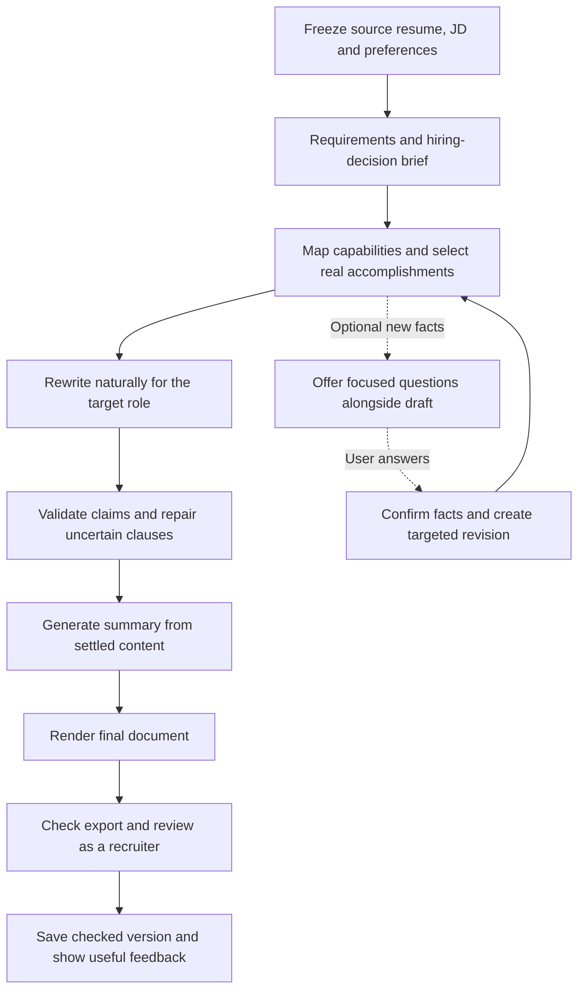

# Resume tailoring implementation master plan

Status: a feature-flagged implementation is now present locally. See [implementation and validation report](2026-09-05-tailoring-implementation-report.md) for shipped code, checks, and rollout limitations. The work packages below remain the original acceptance checklist, not a claim that production rollout or human evaluation has happened. Created 2026-09-05.

This is the single execution checklist for the approved work. It consolidates the architecture, conflict audit, recruiter review, stronger reframing, and naturalness requirements. Earlier documents provide background; do not execute their overlapping task lists independently. Recheck the working tree before editing because summary changes are already in progress locally.

## Outcome

Generate a meaningfully JD-aligned resume that makes the user's strongest relevant experience easy to recognize, remains natural to read, and exports correctly. Support all professions and experience levels. Automatically interpret demonstrated capabilities; do not ask users for proof of ordinary rewording. Ask only optional, focused questions when a material new fact is unknown.

Success is clearer supported fit, not more keywords or a claimed probability of passing a particular ATS.

## Preserve what already works

- Current local summary improvements: JD-ranked evidence, broad-versus-specialist role positioning, optional differentiators, fallback diagnostics, and post-augmentation refresh. Integrate them rather than rebuilding them.
- Ownership checks, source-fact protection, confirmed enrichment, provider abstraction, existing async jobs, entitlement/quota enforcement, version limits, and immutable exported versions.
- Existing candidate-to-job `fit_score` as the only qualification match formula. Resume-writing assessments must not overwrite it.
- Existing PDF extraction/layout checks and the multi-profession evaluation harness.
- User changes and unrelated work in both repositories. Do not reset the working tree.

## Target workflow

The final recruiter review sees only the resume and JD. Factual validation separately sees source facts. One bounded repair may return to writing and rerun affected checks; no semantic writer runs after the final checks. Optional questions never hold an active worker open.

## Work packages in implementation order

### 0. Capture baseline and caller inventory

**Inspect:** backend `resume_service.py`, `resume_tailor.py`, jobs/resume/guest blueprints, `auto_apply_service.py`, existing tests and evaluation fixtures. Locations below are relative to `jobpilot-backend/shared/python/services` unless specified otherwise; frontend paths are relative to `jobpilot-frontend`.

- Census every direct tailor, regenerate, augmenter, and render caller: standalone, combined extraction, batch, guest, jobs shortcut, and auto-apply preparation.
- Record selected base, enabled flags, pipeline revision, input completeness, and generation/repair stages. Do not log raw personal data or prompts.
- Capture original/current outputs using existing fixtures. Measure model calls, latency, fallback and user-correction issues where available. Static review alone is not a quality baseline.

**Done when:** caller matrix and regression fixtures exist; existing local summary changes are identified and preserved; baseline checks report actual results, including unavailable live evaluation.

### 1. Unify writing policy and remove conflicting incentives

**Change:** `prompt_rules.py`, `resume_tailor.py`, `content_augmenter.py`, `integrity_guard.py`, `summary_tailor.py`. **Add:** a small `tailoring_policy.py` shared by prompts and validators; avoid circular imports from writer to policy.

- Remove writing targets of 75–80%/80–90% coverage, mandatory placement of 8–12 terms, forced rewriting of every bullet, ten-metric targets, universal STAR/XYZ structure, and mechanical verb quotas.
- Disable keyword-density insertion, page-fill content generation, and late verb polishing on the new path. Retain legitimate skill deduplication and meaning-preserving formatting.
- Allow substantial semantic reframing automatically: retries can demonstrate failure recovery; indexed query improvements can demonstrate performance optimization.
- Keep tools, ownership, scale, metrics, employers, and credentials accurate. A related technology is not interchangeable with the requested one.
- Permit a supported role label even when it equals the JD title. Remove contradictory subject restrictions.
- Preserve approximation/comparators: `~5,000` becomes "about 5,000"; inclusive `2M+` may become "at least 2 million". Never turn a bounded value into an exact or stronger claim.
- Separate immutable source facts from display selection. Keep all employment/education entries initially, but allow selected bullets, skills, real projects, and credentials; protect required/user-pinned items.

**Done when:** strong original wording can survive; natural JD terms can be added without exact source-word overlap; keyword duplication yields no benefit; true quantities and qualifiers remain intact.

### 2. Build requirement, capability, and selection contracts

**Change:** `resume_service.py` JD extraction, `profile_facts.py`, `keyword_gap_engine.py`, backend `shared/python/schemas/resume_schemas.py`. **Add:** `tailoring_planner.py` and typed internal contracts in a schema module.

- Extract requirements with source spans, explicit required/preferred status, alternatives, and completeness. Replace silent prefix/JSON truncation with bounded section-aware processing.
- Freeze owner-scoped source snapshots. Give facts stable IDs and employer/project context; retain contribution, setting, dates, and metric relationships.
- Map requirements to `demonstrated`, `listed`, `related`, `not_evidenced`, or `needs_clarification`. Supported meaning can be explicit, semantic, or user-confirmed. Model confidence alone is not evidence.
- Create a brief of the role's main work and a few decisive requirements, with explicit versus inferred priorities separated. Infer no private employer scorecard.
- Rank accomplishments by relevance, depth, specificity, recency, and distinct contribution. Favor a few convincing examples over many thin keyword matches.
- Build a selection plan with stable target IDs, source links, ordering, locks, and omissions. Generated wording cannot become a fact source.

**Done when:** alternative requirements work correctly; skills-only evidence does not become employer-specific usage; long-JD requirements are retained or explicitly marked incomplete; technical and nontechnical profiles work without stack quotas.

### 3. Create one orchestrator and integrate every entry point

**Add:** `tailoring_pipeline.py`. **Change:** `resume_service.py`, `resume_tailor.py`, `content_augmenter.py`, `project_generator.py`, jobs/resume adapters and auto-apply preparation as identified in package 0.

- Freeze base revision, source/JD hashes, parent version, policy version, preferences, and deadline once per run.
- Make the writer produce fact-linked patches instead of regenerating protected entity fields. Apply patches against an expected prior hash.
- Route initial, combined extraction, batch, guest, regeneration, jobs shortcut, and auto-apply preparation through the same generation/check sequence. Keep transport/response adapters thin.
- Reuse current summary logic after the body settles. Remove competing late writers from the new path.
- Keep projects source-backed. Suggested future projects belong outside application resumes until actually completed and confirmed.
- Make logical stages share inputs rather than requiring one model call per stage. At most two semantic repair operations and one layout-driven reselection are starting budgets; all provider retries share a deadline.
- Long operations use existing async transport. Reserve quota once; internal retries must not create user-visible versions or extra charges.

**Done when:** all callers share policy and validation; the old augmenter cannot run after a new-pipeline result; regeneration retains user shortening/exclusions and the same evidence snapshot.

### 4. Implement factual, adaptation, and naturalness review

**Change:** `tailor_verifier.py`, `claim_guard.py`, `integrity_guard.py`, `resume_tailor.py`, `summary_tailor.py`; reuse relevant reviewer infrastructure without inheriting a technical-only persona.

- Distinguish explicit support, semantic support, ambiguous new detail, and unsupported/contradicted claims. Accept the first two without questions.
- Validate claim relationships, not only words/numbers appearing somewhere on the resume. Tie tools, results, and ownership to the correct role/project.
- On a weak clause, repair only that clause and preserve good JD-aligned wording. Do not revert a whole resume because one detail is uncertain.
- Review for insufficient tailoring: buried relevant accomplishments, hidden capabilities, generic descriptions, or unnecessary retained base wording.
- Review for over-tailoring: unrelated tools, repeated claims, abstract capability strings, inflated verbs, forced result clauses, JD sentence copying, and loss of source specificity.
- Preserve precise terminology and legitimate multi-tool descriptions. Density/overlap are diagnostic hints, not automatic rejection thresholds. Do not use AI detection or introduce errors to appear human.
- Independent recruiter review receives only the final resume/JD and reports apparent level, visible reasons to interview, and unresolved concerns. Source fidelity is a separate check.

**Done when:** supported reframing passes without questions, uncertain clauses get local repair, clear prose beats stuffed prose with equivalent qualifications, and the recruiter reviewer cannot credit facts absent from the page.

### 5. Make versions, edits, and exported checks reliable

**Change:** `resume_versioning.py`, `resume_service.py`, `resume_renderer.py`, `pdf_ats_check.py`, edit/download handlers; frontend `src/lib/resumeMutations.ts` and relevant version views.

- Separate visible-content hash, source/JD/policy input hash, assessment identity, and artifact bytes hash. Preserve historical hashes and versions.
- Store compact provenance/assessment references, with bounded owner-scoped run records and explicit retention; avoid full raw prompts/graphs in each version.
- User edits invalidate dependent assessments/files and preserve locks/exclusions. Optimistic concurrency protects newer edits from stale jobs.
- Render the exact revision; check extraction, role/date associations, selected metrics/qualifiers, important text retention, clipping, and legibility. Distinguish missing source data from lost extraction data.
- If layout needs semantic trimming, return to selection and recheck affected body/summary claims and visible coverage. Layout-only retry does not regenerate prose.
- Render/extraction failure is failed/unchecked, never assumed format quality. PDF and DOCX checks are separate when requested. A local parser pass is not vendor certification.

**Done when:** no stale pass attaches to new content; assessment-only updates do not change content identity; failed renders cannot look successful; exports match saved versions.

### 6. Replace misleading scoring and feedback

**Change:** `resume_scorer.py`, result schemas; frontend `src/types/resume.ts`, `src/app-shell/pages/craft/tailor/AtsScorePanel.tsx`, `ReviewPanel.tsx`, and associated tests.

- Show three distinct views: document readability, requirement evidence, and recruiter review. Show application constraints separately.
- Remove newly generated vendor simulations, screening/culture-fit probabilities, repetition rewards, and optimistic defaults for unavailable checks.
- Give useful locations/reasons: "Demonstrated in recent role", "Listed, usage context unknown", "Related experience", or "Not evidenced".
- Explain substantive changes and remaining gaps. No universal passing percentage. Rewriting can improve visibility, but does not create qualifications.
- Add versioned assessment fields and frontend readers before new writers. Keep legacy records readable and historical; do not invent vendor fields for compatibility. Do not alter canonical `fit_score` or submission authorization.

**Done when:** users can distinguish qualification support from file readability, unknown checks remain unknown, and old/new results render without misleading labels.

### 7. Add optional discovery of omitted experience

**Change:** existing confirmation flow in `profile_facts.py` and resume blueprints; frontend regeneration/review views. Reuse infrastructure rather than creating a new evidence system.

- Complete a strong draft without questions first. Offer zero questions by default, up to three when unknown facts could materially improve an application.
- Ask neutral questions about actual work, setting, contribution, and optional outcome. Do not suggest a fabricated achievement for blanket approval.
- Accepted answers enter confirmed facts and a new frozen revision. Skipped/no answers do not become evidence. Never assume coursework or personal projects were employment.
- Do not keep a worker waiting or repeat resolved questions. Follow existing version/entitlement rules, disclosing any additional charge before dispatch.

**Done when:** optional answers improve the appropriate scope, no-answer tailoring still works, and draft progress is never blocked by discovery.

## Minimum first release and follow-through

Implement packages 0–6 as one coherent flagged vertical slice before enabling it for users. Package 7 can follow once that slice is stable; normal tailoring must already work without it. Internally land small reviewable changes in the listed dependency order. Do not ship isolated prompt changes while conflicting old writers remain enabled.

The first release needs the contracts and consistent behavior, not new infrastructure or a model call for every box. Preserve existing stored data and user authorizations. All work packages remain in scope; package 7 is explicitly sequenced later, not abandoned.

## Verification checklist

Extend existing tests rather than creating duplicate harnesses. Relevant suites include `test_prompt_consistency.py`, `test_prompt_contract_v2.py`, `test_augmenter_antistuffing.py`, `test_summary_tailor.py`, `test_resume_scorer_v2.py`, `test_profile_facts.py`, `test_resume_layout.py`, `test_verify_pass2_ordering.py`, and `evals/test_tailor_quality.py`. Update obsolete assertions alongside versioned behavior; keep genuine integrity regressions.

- [ ] Same facts, different JDs: meaningful emphasis changes without invented scope.
- [ ] Same JD vocabulary, different experience depth: no false equivalence.
- [ ] Different vocabulary, same demonstrated capability: automatic reframing passes.
- [ ] Related tool stays related; listed skill stays out of unsupported work bullets.
- [ ] Approximate/bounded metrics and entity relationships survive every pass.
- [ ] Strong original content survives; duplication and abstraction do not earn quality credit.
- [ ] All entry points use equivalent checks; regeneration preserves exclusions.
- [ ] Partial extraction, model timeout, rejected patch, and render failure have explicit states.
- [ ] Concurrent edits, changed hashes, stale assessments, and version limits behave correctly.
- [ ] Exported critical text survives extraction with readable layout.
- [ ] Frontend handles legacy, current, incomplete, and failed assessment results.
- [ ] Blind human comparisons cover original/current/new outputs across professions, direct fit, adjacent fit, major gaps, and already-good resumes.

Run affected offline suites per package, then the relevant integration/evaluation suite. Live generation and consenting human review are required to establish prose quality; mocked tests alone cannot do so. Define measurable release thresholds from the baseline before judging experiment results. Monitor latency, model cost, user corrections, fallback frequency, and reviewer disagreement.

## Rollout and completion

Use one pipeline-version flag per run; never mix old/new semantic stages. Introduce schema readers before enabling new writers. Start with a small cohort after checks pass, monitor, then expand. Rollback changes new-run routing while retaining immutable saved results. Do not deploy or submit applications as an incidental part of implementing this plan.

The work is complete when the checklist has recorded results, all adapters use the intended workflow, UI feedback reflects actual checks, optional discovery is delivered, and remaining limitations are documented. No ATS/interview guarantee is implied.

## Supporting references

- [Detailed architecture](../specs/evidence-led-tailoring-architecture.md)
- [Conflict audit](2026-09-05-tailoring-conflict-audit.md)
- [Recruiter reverse review](2026-09-05-recruiter-reverse-review.md)
- [Earlier product rationale](2026-09-05-evidence-led-resume-tailoring.md)
- [Summary workstream](2026-09-05-jd-adaptive-summary.md)
