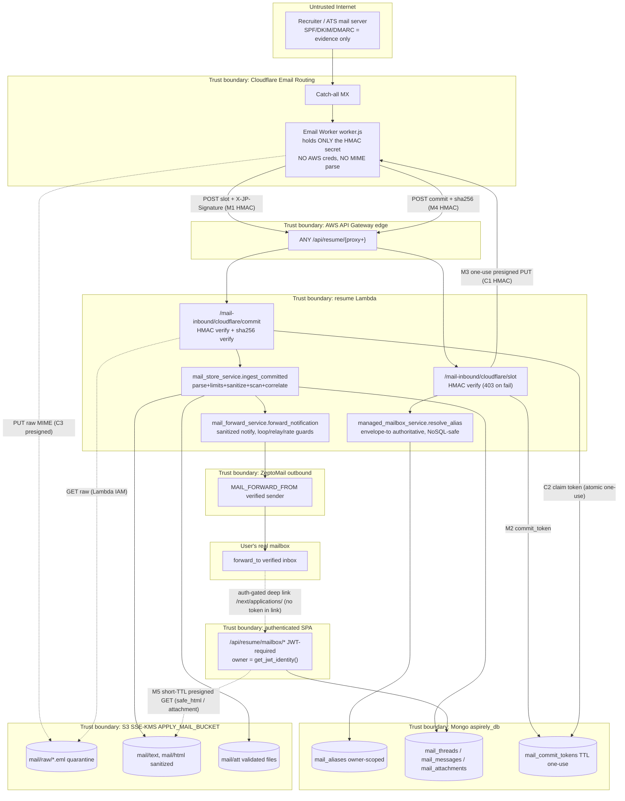
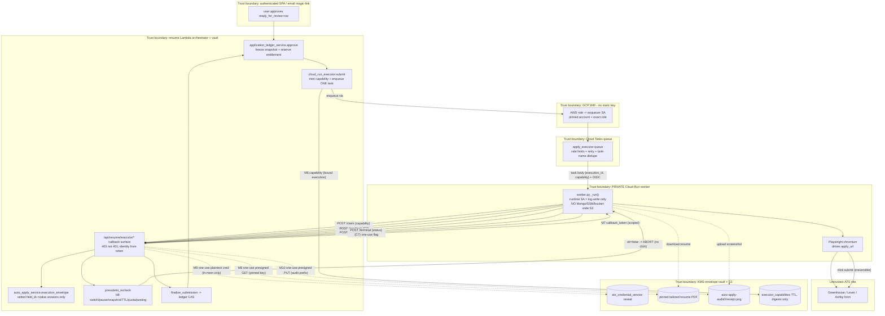

# Data-Flow & Trust Boundaries — Auto-Apply + Managed Mailbox

Two planes, each crossing several trust boundaries. Every **capability / token /
presigned URL** is annotated where it is *minted* (M) and *consumed* (C). Trust
boundaries are drawn as subgraph borders; data crossing a border is fully
untrusted on the far side.

Legend: `M#` = minted here · `C#` = consumed here · dashed edge = one-use / short-TTL
capability.

---

## Plane 1 — Mail ingress (recruiter email → durable inbox → user's real inbox)

**Boundary notes (mail).**
- **M1/M4 HMAC** is the *only* edge auth (`webhook_hmac.verify`, constant-time,
  empty-secret fail-closed). SPF/DKIM/DMARC are stored as evidence, never a gate.
- **M2 commit_token** binds the presigned PUT to the resolved owner + message id
  in `mail_commit_tokens` (TTL 15 min, one-use CAS `claim_commit_token`).
- **M3 presigned PUT** is single-object (`raw_key_for`), single-use; the Worker
  holds no AWS creds — the URL is its entire capability.
- **M5 presigned GET** (5-min TTL) is the only way a client touches S3 bodies;
  raw MIME (`raw_s3_key`) is **never** exposed in any API field.
- Owner identity is always the JWT identity (user API) or the envelope-resolved
  alias owner (ingest) — **never** a body/MIME identity (D7 / IDOR defense).

---

## Plane 2 — Auto-apply execution (approval → dispatch → remote browser → ledger)

**Boundary notes (execution).**
- **M6 capability** rides the task body — the worker's only starting secret;
  claimed exactly once (`claim_capability` CAS) → double-dispatch backstop
  *before* any browser launches. Task name = `execution_id` also de-dupes at the
  queue layer.
- **M7 callback_token** authenticates every follow-up; only digests are stored
  (`executor_capability_service._digest`); each resource issuance is
  independently one-use (`_mark_issued`).
- **M8/M10 presigned URLs** are scoped to the ONE pinned résumé key
  (`pinned_resume_s3_key`, owner-scoped) and the ONE receipt key under
  `auto-apply-audit/<app>/<exec>/` — never bucket-wide.
- **M9 credential** is decrypted just-in-time via the KMS-envelope vault,
  returned once over TLS, held in worker memory only, never logged/disked.
- The **precheck** is the re-validation choke point (kill-switch, pause,
  approval snapshot drift/TTL, entitlement-held, posting) evaluated **server-side**
  immediately before the irreversible click; `submission_unknown` after the click
  is **held, never auto-retried**.

**The one border with no control today:** the `PW → FORM` edge. `apply_url` is
attacker-influenceable (it originates from a job posting recorded on the ledger
row) and the worker navigates it with a full browser that has **no request
interception, no egress allow-list, and no metadata-server block** — see the
audit (P0-1/P0-2). Everything else on this plane is one-use, owner-scoped, and
short-TTL; this edge is the exception.
