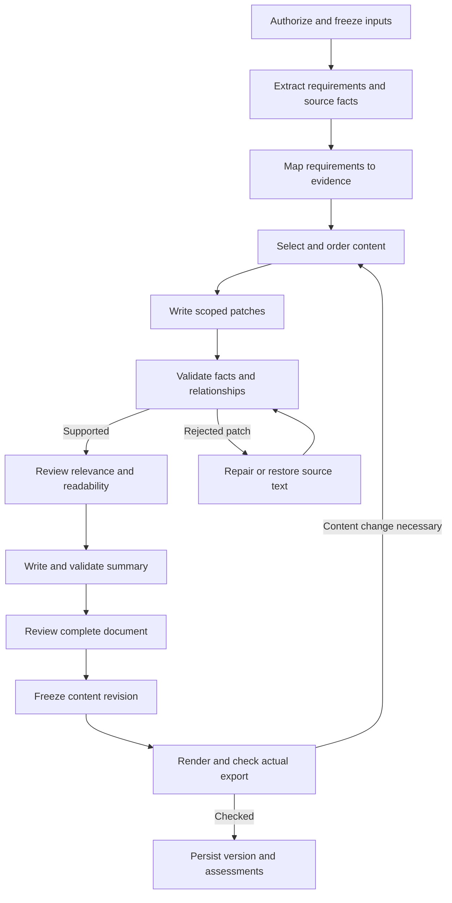

# Evidence-led tailoring: proposed architecture and workflow

Status: proposed target contract, 2026-09-05; not a claim about deployed behavior. This resolves the [conflict audit](../plans/2026-09-05-tailoring-conflict-audit.md) and refines the [whole-resume plan](../plans/2026-09-05-evidence-led-resume-tailoring.md). Its stage ordering and failure rules supersede earlier proposals for implementation. Preserve the summary improvements already present locally.

## 1. Architecture decisions

Recruiter-side review: [reverse analysis and validation design](../plans/2026-09-05-recruiter-reverse-review.md). The plan is promising but unvalidated; implement the decision brief, evidence depth, and independent reader checks below before judging success by a score.

- One orchestrator in the existing shared service layer; no new microservices or independent queues.
- Select source evidence before writing. The JD supplies requirements, never candidate facts.
- Separate immutable factual values from selectable display content. User locks and exclusions persist.
- One typed, versioned policy feeds prompts, validators, and assessments. Truth rules are hard constraints; preferred length and style are guidance.
- Assess actual support, readable accomplishments, and real exports. Do not simulate vendor decisions or reward repetition.
- Semantic changes create candidate revisions and invalidate checks. No semantic writer runs after final approval.
- Keep candidate-to-job `fit_score` independent: rewriting cannot create qualifications.
- Give the writer substantial freedom to reframe, combine, and surface real experience. Missing wording is not automatically missing experience; use focused evidence discovery when a material detail is unknown.
- Evidence checking is an internal reasoning step, not a default request for user proof. Automatically derive accurate capability language from described actions; evaluate semantic support rather than literal word overlap. Questions are exceptional and optional.

## 2. Stage ownership

| Owner | Responsibility | Prohibited responsibility |
|---|---|---|
| Existing routes/workers | Authorization, quota reservation, dispatch, progress, response adapters. | Independent tailoring sequences. |
| Proposed `tailoring_pipeline.py` | Own order, context snapshots, revisions, budgets, recovery, and result assembly. | Generating facts or a second match score. |
| Proposed `tailoring_policy.py` | Shared immutable policy and schema/prompt versions. | Circular imports from the writer or copied rule lists. |
| JD analysis and requirement mapper | Source-linked requirements, alternatives, explicit versus inferred priority, completeness. | Turning marketing language into mandatory qualifications. |
| Extended `profile_facts.py` | Source snapshot, stable scoped facts, confirmed enrichment. | Using generated text or style preferences as evidence. |
| Proposed `tailoring_planner.py` | Evidence links, relevance selection, section budget, locks/omissions. | Keyword quotas or rewriting history. |
| Refactored `resume_tailor.py` | Scoped prose patches from selected facts. | Restoring excluded content or inventing projects. |
| Existing guards plus scoped validator | Check entities, relationships, metrics, claim support. | Silent mutation during assessment. |
| Final human-quality reviewer | Cited clarity/relevance issues and bounded repair proposals. | Overriding factual failures with a score. |
| Current `summary_tailor.py` | Summary from final approved body and requirements. | Independent source snapshots or mandatory stacks. |
| Renderer/export checker | Layout and actual file checks. | Filling whitespace with new accomplishments. |
| Assessment/UI | Read-only coverage, review, gaps, and export status. | Generating resume claims or vendor probabilities. |

Decompose the augmenter: selection belongs to the planner, supported repair to the writer, and layout to the renderer. Disable old density/page-fill writers for the new path. Retain useful normalizers only where they preserve meaning.

## 3. Internal contracts

Adapt internal contracts to existing resume JSON at the rendering/API boundary. Keep metadata out of prose.

| Contract | Required information |
|---|---|
| `RunContext` | Owner scope, operation/run/idempotency IDs, base revision, parent version, source/JD hashes, policy/schema/model versions, edits, locks, deadline and budget. |
| `CandidateFact` | Stable snapshot-namespaced ID, source excerpt/kind, entity and dates, action, capability, ownership, outcome, confirmation state. Metrics include quantity, unit, comparator, approximation, timeframe, and associated accomplishment. |
| `JobRequirement` | Stable ID, exact excerpt/span, type, required/preferred/unspecified status, inferred priority separately, alternative group, canonical terms, extraction confidence. |
| `EvidenceLink` | Requirement ID, fact IDs, state (`demonstrated`, `listed`, `related`, `not_evidenced`, `needs_clarification`), explanation and permitted terminology. |
| `TailoringPlan` | Selected facts/entities, bullet order within roles, skills/projects/credentials, supported positioning label, coverage assignments, layout intent, locks, omissions with reasons. |
| `HiringDecisionBrief` | Main work and expected scope, a small set of decisive requirements, explicit versus inferred priorities, strongest supporting examples, and material uncertainties. Planning hypotheses, not access to employer-private criteria. |
| `ContentPatch` | Stable target ID, expected prior hash, replacement text, source fact/requirement IDs, and reason. |
| `ReframingDecision` | Requirement/fact IDs, transformation (`terminology`, `emphasis`, `synthesis`, `transferable`, `confirmed_addition`), supported scope, unresolved factual details, and rationale. |
| `EvidenceQuestion` | Requirement ID, missing factual detail, neutral question, source entity if known, answer/skip state, and confirmed fact IDs. A question is not evidence. |
| `Assessment` | Document/input/policy identity, type, state (`passed`, `issues`, `unverified`, `failed`, `not_applicable`), cited findings, timestamp. |
| `Artifact` | Format, document hash, renderer/layout version, bytes hash, immutable storage key, rendering/extraction status. |

Stable IDs survive reordering; list indexes alone are insufficient. "Supported" means supported by user-provided sources, not externally verified employment. Distinguish safe aliases from related methods. A listed skill can remain in Skills without becoming employment experience. Alternative requirements follow group logic; do not count both sides of "A or B" as mandatory.

Add `support_basis` to evidence links and reframing decisions: `explicit`, `semantic`, or `user_confirmed`. A semantic link states why the described action demonstrates the capability without introducing a new event, product, responsibility, scope, or outcome. Both explicit and valid semantic support can establish `demonstrated`; the capability does not need to occur verbatim in the source. Related experience remains `related` when that entailment does not hold. Model confidence alone cannot promote it.

## 4. Canonical workflow

Loops share a bounded repair budget. Layout-only retries stay in rendering.

### Stage 0: freeze the run

Reuse authorization and entitlement checks; reserve once. Resolve the base once and freeze its source facts, JD, and preferences. Regeneration uses its parent version's base snapshot unless the user changes it. Background resume/enrichment edits cannot change a running job. Guest snapshots contain only guest-owned data.

### Stage 1: analyze

Read the JD with section-aware bounded extraction. Chunk oversized input and reconcile requirement IDs/source spans. Report partial analysis on incomplete extraction rather than silently claiming complete coverage. Retrieve evidence structurally rather than slicing serialized JSON.

Use existing resume facts and confirmed enrichment. Do not browse or import additional user data implicitly. Preserve input sanitization and untrusted-data wrapping for model calls. An optional clarification can add confirmed evidence to a new snapshot; absent answers are not facts.

### Stage 2: map and select

Rank source accomplishments by relevance, evidence strength, recency, and distinct contribution. Deterministic mapping handles safe aliases; semantic matching can resolve ambiguity with cited sources, never by inventing equivalence.

First create a hiring-decision brief identifying the role's main work, level, and a few decisive requirements (roughly three to five as a starting heuristic, not a quota). Choose the strongest visible reasons to interview. Track evidence depth: work/project/course setting, recency, contribution, ownership, scope, frequency, and outcomes when stated. A capability match alone does not prove the level of experience requested. Unknown depth remains unknown. Preserve distinctive accomplishments and prioritize the strongest relevant material early without making all prior roles resemble the target job.

Keep actual employers/titles/dates. Initially retain employment/education entries while selecting their bullets; later compact-history support is a separate tested policy. Select relevant real projects, skills, and credentials, protecting required/pinned items. Preserve source values without requiring every source fact to appear. Record omissions so restorers cannot silently undo them.

### Stage 2a: reframe supported work and discover unstated experience

**Default: active tailoring with no questions required.** A resume is a compressed account of work, not an exhaustive vocabulary list. Build a capability map from its actions and context, use that map to select the JD's accurate terminology, then rewrite for the target role. Evidence references are maintained internally and are not a demand for users to document every sentence.

Before proposing a question, try these operations automatically: interpret the described action, combine compatible source context, name the demonstrated capability, identify a transferable responsibility, and rewrite at the strongest supported level. Ask only if a material new factual claim is still needed; a missing JD phrase alone must never trigger a question.

The goal is the strongest credible application, not minimal paraphrasing. The writer may change sentence structure, emphasis, accomplishment order, and professional terminology substantially when the meaning remains supported. Do not reject a rewrite merely because its words differ from the source or because a valid capability label is absent verbatim.

| Evidence situation | Permitted action | Boundary |
|---|---|---|
| Same work, different terminology | Name the demonstrated capability using accurate JD terminology. | Related tools/methods are not automatically equivalent. |
| Capability clearly demonstrated but never named | Derive a concise capability label from the action and use it naturally, with an internal semantic rationale. | Do not assume activities merely because they are typical of a job title. |
| Relevant work buried in a generic bullet | Lead with the relevant action or outcome; compress secondary detail. | Do not increase ownership, scale, or certainty. |
| Complementary facts about the same accomplishment | Synthesize a coherent bullet, retaining every supporting fact reference. | Do not invent causality or combine separate employers/projects into one event. |
| Transferable experience | Explain the existing work through a shared responsibility, such as reporting automation or customer issue resolution. | Do not claim the target tool, industry, certification, or specialist title without evidence. |
| Potentially relevant experience omitted from the resume | Ask a targeted factual question and add the user's confirmed detail. | Do not draft a desired achievement and ask for a blanket approval. |
| No supporting experience or user says no | Present adjacent strengths and leave the specific requirement not evidenced. | Do not manufacture experience to close the gap. |

**Discovery flow:** after automatic reframing, offer zero questions by default and at most three optional high-value unknowns per application when answers could materially strengthen it. This cap is not a target. Ask about the missing relationship: what the user actually did, where, their contribution, and the result if known. Do not ask routine permission to rewrite supported facts or name semantically demonstrated capabilities. Reuse already confirmed answers within their proper scope, and do not re-ask skipped questions in the same application unless the user reopens them.

For example, when a tool is only listed in Skills: "Where have you used this tool, and what did you do with it?" Accept work, coursework, personal-project experience, no use, or a skip. Do not assume paid production use. For a generic accomplishment, ask only for the missing details needed to strengthen it; metrics are optional.

Generate a useful draft immediately from existing evidence while optional questions remain available. Never keep a worker waiting for a human response. Answers create confirmed source facts with the user's wording and scope, then a new frozen input snapshot for a targeted revision. If an answer contains multiple ambiguous claims, confirm only those unresolved claims before adding them. Silence, a generic "make it stronger", or approving a stylistic rewrite is not factual confirmation.

Use the existing confirmation and revision infrastructure. An answer-triggered refinement follows the existing entitlement/version policy; define and disclose any charge before dispatch, never consume a second quota silently. The earlier draft remains available, and no stale async response can overwrite a newer one.

**Default presentation:** supported reframing is automatic. Optional questions appear as "Add relevant experience" next to important gaps. The change explanation distinguishes "Reframed existing work" from "Added details you confirmed". Do not expose an aggressiveness slider that implies users can trade accuracy for a higher score.

**Examples (illustrative source facts, not reusable claims):**

- Source: "Added retries for failed background jobs." JD: reliability. Automatic rewrite: "Implemented failure recovery for background jobs by retrying unsuccessful executions." This adds useful capability language without asserting uptime, fewer incidents, or a specific retry strategy.
- Source: "Added SQL indexes and reduced report query time from 8 seconds to 2 seconds." JD: database performance optimization. Automatic rewrite: "Optimized database query performance with SQL indexes, reducing report execution time from 8 seconds to 2 seconds." No additional confirmation is needed.
- Source: "Worked with designers and QA to release a checkout feature." JD: cross-functional delivery. Automatic rewrite: "Worked with design and QA to release a checkout feature." The collaboration demonstrates the capability; an abstract label is optional. Do not upgrade participation to sole delivery or team leadership.

- Source: "Automated weekly sales reports in Excel." JD: process improvement. Valid: "Automated weekly sales reporting in Excel to streamline report preparation." No claim of time savings or organization-wide leadership without additional evidence.
- Source: "Used RabbitMQ to process background jobs." JD: Kafka/event-driven systems. Valid emphasis: "Implemented asynchronous background-job processing with RabbitMQ." Kafka remains not evidenced; do not replace the product name.
- Source: "Resolved customer tickets and documented recurring issues." JD: customer operations. Valid: "Resolved customer support requests and documented recurring issues for follow-up." Do not invent improved satisfaction scores or a new escalation process.
- Confirmed addition: the user states they wrote regression tests for a specific employer's release workflow. A new testing bullet is allowed for that employer; test coverage percentages, release ownership, and reduced defects still require their own support.

Newly confirmed experience may change factual fit when the canonical `fit_score` is recomputed on the updated source snapshot. Reframing alone must not promote evidence status or be treated as newly acquired qualifications. Document visibility can improve while underlying qualification evidence remains the same.

### Stage 3: write and validate

Copy protected identity fields directly. Give the writer specific facts for each patch. Favor one understandable accomplishment with action, work, and supported outcome/scope. Metrics are optional; exact JD language is used only when true. Already-strong bullets may stay unchanged.

Check entity scope, ownership, dates, quantities, approximation, negation, tools, and outcome relationships. Deterministic checks cover exact invariants; semantic entailment covers relationships that string matching cannot establish. Require fact IDs but also check that the linked facts actually support the text. Rejecting unsupported content strengthens existing guards; do not remove them without equivalent or better coverage.

Source `~5,000` may become "about 5,000"; source `2M+` may become "at least 2 million" when it denotes a lower bound. Preserve the source form if its meaning is ambiguous; do not turn an inclusive bound into a strict one. Numbers or tools found in another role cannot ground this bullet.

### Stage 4: human review and summary

Review the settled body against source evidence and job priorities. Diagnose whether leading content establishes fit, accomplishments are specific, bullets are distinct, scope is credible, and language is understandable. Adapt to profession and seniority; no universal technology or metric minimum.

Apply one bounded quality-repair batch, validate it, and compare with the prior body. Then use the improved summary writer on that approved body. Review the complete document for repetition and contradictions. Summary and body share the same frozen facts and policy. Cosmetic normalization must precede this check or be proven meaning-preserving.

Separate review input scopes: factual validation and repair may use the full source snapshot. The independent final reader review receives only the finished resume and JD, without internal evidence notes, scores, or writer rationale. It reports apparent role/level, visible reasons to interview, and unresolved concerns with cited resume passages. Run the reader check on the rendered document in the export stage; it supersedes any assumption that an internal content review predicts the employer's impression. Use the same bounded budget rather than adding endless reviews. A reader cannot give credit for source facts that did not reach the page.

For substantial reframing, add an interview-defensibility check: can the user explain the action, setting, personal contribution, and claimed outcome using the cited facts? Accept truthful qualitative accomplishments. Flag implied expertise, ownership, causal results, or production experience that the source does not establish. This is a content-grounding rubric, not a claim to predict interview performance.

### Validation refinement: protect meaning without suppressing tailoring

Split findings into `supported_explicit`, `supported_semantic`, `ambiguous_new_detail`, and `contradicted_or_unsupported`. Accept the first two without user interaction. On an ambiguous clause, keep the strong supported portion and remove or rephrase only that clause; do not revert the entire bullet/resume to its base wording. Optional discovery may recover the omitted detail later. A role title alone is not enough to invent common duties.

Update `tailor_verifier` accordingly: its current PARTIAL category mixes semantically justified generalization with plausible new detail. Its blanket allowance for role-standard activity also needs narrowing to demonstrated actions/context. Preserve internal source links while distinguishing those cases. Apply the same acceptance policy to the writer, summary, reviewer, and repair stages.

Add an adaptation review alongside factuality: identify important supported JD capabilities still hidden in generic wording, relevant accomplishments buried below weaker ones, and unnecessary base-summary/skill retention. Propose a targeted rewrite when those problems remain. Do not require a minimum edit percentage or change an already well-aligned resume for novelty.

Acceptance order: factual validity first; then useful requirement visibility and human clarity together. Prefer a candidate that makes supported fit easier to see without sacrificing readability. Neither lexical similarity to the source nor more keyword occurrences earns a preference. Preserve valid natural JD terminology even when the original used different words.

### Stage 5: artifact validation

Before freezing for export, apply the naturalness contract below as part of the complete-document review. It uses the existing reviewer/repair budget, not another unbounded polishing pass.

Freeze content, render, and inspect extracted text plus layout. Check contact data present in the source, section order, role/date associations, selected claims/metrics/qualifiers, important terms, clipping, and legibility. Missing user data differs from lost extraction data. PDF and DOCX checks apply separately when requested.

Try layout-only adjustment first. If content changes are necessary, return to selection once; respect locks, then rerun affected grounding, body review, and summary checks. Coverage is recomputed from retained content. An earlier pass never certifies changed text. Local extraction is useful evidence, not proof of a vendor's parser behavior.

### Stage 6: commit and show

Persist the exact checked content, provenance references, assessments, and artifact identity. Show document readability, requirement evidence, recruiter-review findings, changes, and remaining gaps. Keep existing auth, version caps, quota settlement, and submission authorization.

A useful draft may be returned when optional review is unavailable, explicitly marked incomplete. Auto-apply preparation must not mark an artifact ready while required factual/export checks are unresolved. This is artifact readiness, not authorization to submit.

## 5. Naturalness and keyword discipline

The target is a clear resume that sounds like a person describing actual work. Strong alignment is compatible with recognizable source accomplishments and natural phrasing. Do not optimize for looking less AI-generated, use an AI detector, introduce deliberate errors, or weaken accurate technical language merely because it matches the JD.

**Composition policy:**

- Keep strong original wording when it already communicates relevant work. Rewrite where it improves relevance or clarity; there is no requirement to change every bullet or hit an edit percentage.
- Use each important supported term where it belongs. A skills entry plus a meaningful accomplishment can be useful; repeated appearances must add distinct context, not satisfy a count. Do not require every matched term in the summary, Skills, and Experience.
- Preserve specific objects and actions: the report, workflow, service, campaign, customer issue, or process the person actually worked on. Do not replace these with a string of abstract JD capabilities.
- Use one coherent accomplishment per bullet. Several tools are acceptable when their relationships explain the work; unrelated tools appended at the end are not. There is no profession-independent numeric tool limit per bullet.
- Use results and metrics when available, without forcing every bullet into STAR/XYZ or fabricating a result clause. Plain task/scope descriptions can carry useful evidence. Vary sentence shape as the facts warrant, not through a template quota.
- Prefer accurate everyday verbs. Repeating "Built" can be better than substituting an inflated synonym to satisfy verb diversity. A sophisticated term is appropriate when it conveys something precise.
- Retain relevant career context and distinctive accomplishments beyond exact JD matches. Do not make every historical role sound like the target job, or copy the JD's order and responsibility sentences wholesale. Keep chronological history and truthful differences between roles visible.
- Reuse the user's own wording preferences from `edit_signals` as optional style context across initial and regenerate flows. Preferences guide tone, never facts; do not preserve poor clarity simply to mimic the base resume.

**Reviewer checks:** identify concrete spans with unrelated term lists, redundant capability labels, repeated claims across sections, unnecessary exact-JD phrases, inflated verbs/adjectives, formulaic result clauses, or lost source specificity. Lexical overlap, repeated sentence openings, and term density are diagnostic signals only, not automatic rejection rules. Common professional terminology may legitimately overlap with a JD.

For every proposed deletion, ask whether removing the phrase loses meaningful evidence or useful identification of a qualification. Remove it when it contributes neither. Preserve a term when it accurately identifies the tool/capability used and helps explain the accomplishment. Prefer a simpler candidate with equivalent supported coverage over a longer, denser rewrite. Recompute coverage after edits, but do not reinsert a removed phrase merely to raise a score.

**Repair behavior:** edit only flagged spans; simplify without discarding good JD alignment or reverting the whole resume. Factuality, adaptation, and naturalness are assessed together in the existing review pass. If a repair improves keyword coverage but reduces clarity or credibility, keep the better prior version. Cosmetic polishing must stop once meaningful issues are resolved.

**Example:** source facts say the user added retries for failed background jobs. Useful alignment: "Added retry handling to recover failed background jobs." Over-tailored wording: "Engineered robust, scalable, resilient asynchronous workflows leveraging fault tolerance, operational excellence, and enterprise reliability." The second adds abstractions and unsupported scope instead of helping the reader understand the work. No extra question is needed to choose the first.

**Migration:** remove conflicting primary-prompt requirements to rewrite every retained bullet, place 8–12 keywords into work/project sections, aim for at least ten metric-bearing bullets, and enforce STAR/XYZ universally. Replace mechanical verb quotas and late verb-strengthening rewrites with the checks above. Preserve source-backed impact, useful skill grouping/deduplication, and the existing prohibition on fabrication.

**Evaluation:** add paired fixtures where both versions mention the same supported qualifications but one is stuffed, inflated, or repetitive. Prefer the clear version. Also test that a legitimately technical multi-tool bullet is retained, natural exact terminology is not stripped, and an already effective resume does not undergo needless rewriting. Blind reviewers assess specificity, readability, credibility, and useful job alignment; do not invent a universal "genuineness" percentage.

## 6. Failure policy and budgets

| Condition | Outcome |
|---|---|
| Source unavailable/corrupt or unauthorized | Existing actionable failure; never generate from JD alone. |
| Partial requirements extraction | Limited draft and partial coverage state, not complete success. |
| Unsupported patch | Targeted repair within budget, then restore source/last supported text or omit the unsupported optional addition. |
| Grounding evaluator unavailable | Preserve source-derived text; mark uncertain transformations unverified. Timeout never means support. |
| Human reviewer unavailable | Keep fact-supported draft and report review unavailable. |
| Summary fails | Source-supported fallback with notice; check it against retained body. If incompatible, omit the optional summary with a reason. Honor explicit omission requests. |
| Render/extraction fails | Retain draft, retry export within budget, mark that format failed. No bytes means no readability pass. |
| Edit/result is stale | Reject by expected parent/content hash; do not overwrite newer edits or attach stale checks. |

Initial budget proposal: one extraction (chunked only when needed), one body composition, one body review, one summary generation, and a shared maximum of two semantic repair operations. Allow at most one layout-triggered reselection. All model/transport retries consume the same run deadline. Required validation still runs; when budget is exhausted, restore/omit/report rather than skip checks. Calibrate time/cost ceilings from baseline measurements before rollout.

## 7. Versioning, cache, and edit semantics

Keep bounded embedded content versions. Store compact diagnostics and references to an owner-scoped bounded run record for evidence maps; specify retention/deletion with source snapshots resolvable for the saved version's lifetime. Do not duplicate raw prompts/full fact graphs in each version.

Separate input hash, visible content hash, assessment identity, and artifact bytes hash. Cache keys include owner, inputs, and relevant policy/schema/model versions. Historic hashes remain untouched; add the new hashes for new versions. Migrate readers before writers. Legacy results stay readable and are unassessed under the new policy until explicitly reassessed.

User edits create revisions and invalidate dependent checks/artifacts. Style feedback is not factual confirmation. Explicitly confirmed facts enter the fact store; generated wording or an arbitrary edited sentence must not silently become grounding for future generations. Persist locks and exclusions across regeneration.

Use optimistic concurrency on expected parent version. Internal repair revisions do not consume user-visible version slots or another tailoring quota. Upload under immutable artifact keys; publish references only for the matching content/checks. Interrupted/stale runs cannot move the current-version pointer. Assessment-only updates cannot change visible content identity.

## 8. Integration and rollout

1. Census all tailor/regenerate/augment/render callers, including standalone, combined extraction, batch, guest, jobs shortcut, and auto-apply preparation. Record current runtime flags and baseline outputs.
2. Add policy/contracts, scoped facts, selection plan, and behavior tests. Resolve obsolete prompt conflicts without weakening factual protections.
3. Introduce the orchestrator behind a versioned flag. Route adapters keep existing response shapes; long jobs use existing async transport. Disable competing old writers on this path.
4. Add complete-document checks, export identity, edit invalidation, and failure states. Preserve the current summary improvements while moving ownership into this workflow.
5. Add new assessment fields and frontend readers. Remove newly generated vendor simulations; historical scores remain clearly historical. Do not fabricate old scanner fields to satisfy old clients. Keep `fit_score` and apply authorization unchanged.
6. Run deterministic contracts, end-to-end entry-point parity, export tests, and blind multi-profession prose comparisons. Then stage rollout with cost/latency/failure monitoring and rollback for new runs. Never rewrite saved user versions during rollout.

## 9. Release evidence required

- Every generated claim cites supporting facts and survives scope/relationship checks in regression fixtures.
- Skills-only evidence never creates employer-specific usage; related tools remain related; alternative requirements are evaluated correctly.
- Substantial but supported reframing passes even without verbatim source/JD overlap; measure missed opportunities as well as unsupported additions.
- Reliability from retries, performance optimization from indexed query improvements, and cross-functional delivery from documented collaboration pass automatically without user questions. Typical duties inferred from a title alone do not.
- An uncertain clause is repaired locally; other useful JD-aligned wording survives. A no-answer run still produces the strongest supported tailored draft.
- Evaluate adaptation on profiles whose accomplishments support the JD but use different vocabulary. Blind reviewers should recognize the target responsibilities more clearly without finding extra unsupported scope or keyword lists.
- Confirmed unstated experience can add a scoped bullet; unanswered/skipped questions cannot. Coursework and personal projects cannot become employment claims.
- Synthesized bullets preserve entity boundaries and causal relationships; merging facts does not create new ownership or outcomes.
- Optional evidence discovery never blocks the existing draft, repeats resolved questions, silently consumes another quota, or overwrites newer edits.
- Retained metrics preserve units, approximation, comparator, and outcome association.
- A keyword copied ten times cannot improve requirement support or readiness.
- Shortening/exclusion requests survive regeneration and layout; all entry points use equivalent checks for identical frozen inputs.
- No changed document retains a stale pass; no render failure appears successful; concurrent results cannot overwrite newer content.
- Selected critical fields survive exported text extraction, with readable layout across sparse and long profiles.
- Human blind review supports improved relevance/clarity across professions; model judges are supplemental. Mock tests prove contracts, not writing quality.
- Compare original, current-pipeline, and proposed outputs with blinded/randomized reader review on the JD and final resume only, followed by a separate source-fidelity audit. Include already-good and materially mismatched applications. Track reader disagreements, user correction burden, and latency as well as visible fit.

Set measurable rollout thresholds after the baseline rather than inventing an ATS pass percentage. The architecture is designed to be coherent and testable; quality and reliability must still be demonstrated through implementation and evaluation.
